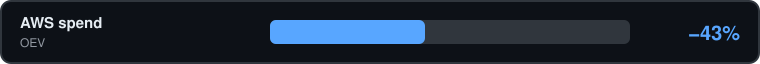

  

  <a href="https://linkedin.com/in/rishi-srinivasan"> LinkedIn</a> ·
  <a href="mailto:rishi.srinivasan95@gmail.com"> Email</a> ·
  <a href="https://rsrinivasan.de"><picture><source media="(prefers-color-scheme: dark)" srcset="assets/icon-portfolio-dark.svg"></picture> Portfolio</a> ·
  <a href="https://medium.com/@rishi.srinivasan95"><picture><source media="(prefers-color-scheme: dark)" srcset="https://cdn.simpleicons.org/medium/ffffff"></picture> Writing</a>

## About

As a Site Reliability Engineer, I keep platforms reliable, and ship the LLM systems that run on them. Eight years across machine learning, backend and cloud, in regulated environments: online banking, insurance, healthcare.

At **Scalable Capital** in Berlin I own the Datadog platform and the company's LLM gateway. Before that I owned a production LLM application for 1000+ users at **OEV** and delivered cloud and ML work for Bank of Montreal, Equinor, Transgrid and JERA at **Tata Consultancy Services**.

English (full professional) · German (B1) · French (A2)

## Results

Bar length is the size of the reduction. Click a result for how it was done.

Architectural decisions on the Datadog platform that cut cost by 74% while keeping observability intact, plus weekly cost reporting broken down by indexed telemetry, service and AWS account.

Rightsizing, autoscaling and removing idle resources, with no loss of performance or availability.

Multi-stage CI/CD pipelines standardised across GitHub Actions and GitLab CI, alongside the move of 20+ microservices to Azure with zero-downtime deployments.

Evals built with the customer and internal stakeholders to refine prompts and model behaviour in a production LLM application classifying rehabilitation case documents for 1000+ users.

Also: about 24 hours a month of manual cost reporting replaced by a scheduled AI workflow on the Datadog MCP server, and 200+ multipage insurance documents processed in 3 months by a TypeScript service.

## Experience

 **Cloud Site Reliability Engineer II · [Scalable Capital](https://www.scalable.capital)** · Jul 2026 – now · Berlin
- Led a 3-month proof of concept of Dash0 as a Datadog replacement: set the success criteria, integrated 5 core services, ran governance and permissions, onboarded 15+ engineers in 3 workshops, and turned developer feedback into feature requests with Dash0's product teams.
- Automated Datadog cost reporting with scheduled tasks on the Datadog MCP server, publishing weekly and monthly slides for the VP Engineering and CTO.
- Operate Bifrost, the LLM gateway: cost, latency and token tracking across teams, MCP connectors, budgets, rate limits and alerts.
- Own the Datadog platform; cut its cost by 74% while keeping observability intact.

 **DevOps Engineer · [OEV](https://www.oev-online.de) (Sparkasse Versicherung Group)** · Nov 2022 – Jun 2026 · Berlin
- Owned a production LLM application (Python, LangChain, LangGraph) end to end for a healthcare customer, classifying rehabilitation case documents for 1000+ users. Built evals with the customer and cut false positives by 94%.
- Designed and ran its cloud infrastructure: containers, CI/CD, guardrails, observability, cost controls.
- Built a TypeScript document service that pre-fills policy forms from insurance certificates, and a market-monitoring pipeline that summarises competitor pricing changes with Slack alerts.
- Migrated 20+ microservices from on-premises to Azure (AKS, ACI, Terraform) with zero downtime; standardised CI/CD in GitHub Actions and GitLab CI.
- Started as Associate DevOps Engineer and cut AWS costs by 43%.

**Data Scientist, then Associate Systems Engineer · Tata Consultancy Services** · Sep 2017 – Sep 2021 · Chennai
- Shipped an end-to-end ML pipeline predicting coal properties for JERA, working directly with their engineers.
- Delivered backend and cloud work for Bank of Montreal, Equinor and Transgrid, including a Windows banking monolith moved to cloud-native C# microservices on AWS CDK.

## Projects

**[PII gateway](https://github.com/rishi-srinivasan/gtc-berlin-week-hackathon)** · GTC Berlin Week hackathon · 19 Oct 2026
Customer Support emails and contact forms at a regulated enterprise like a bank or online investment broker are full of PII (Names, IBANs, tax IDs, Depot Numbers, etc). A small self-hosted language model (SLM), distilled from a larger teacher (frontier LLM) with distil labs, finds the German PIIs based on regulatory requirements of BaFin, GDPR, and DORA. SLM swaps it for placeholders like `[IBAN_1]` and only the masked text reaches the frontier LLM, and the reply is rehydrated. Leak rate is measured against gold labels, every call is traced in Langfuse, and leak-free teacher traces become new training rows for the next student.

**[llm-eval](https://github.com/rishi-srinivasan/llm-eval)** · 17 Sep 2026

**[harness-testing](https://github.com/rishi-srinivasan/harness-testing)** · 25 Aug 2026

## Writing and teaching

<picture><source media="(prefers-color-scheme: dark)" srcset="https://cdn.simpleicons.org/medium/ffffff"></picture> 29 Nov 2025 · [Building Enterprise-Grade Cloud Infrastructure: A Deep Dive into OOP and Reusable Components with Pulumi](https://medium.com/@rishi.srinivasan95/building-enterprise-grade-cloud-infrastructure-a-deep-dive-into-oop-and-reusable-components-with-e3441b89168e)

 Guest lecturer for the Cloud Computing module of the M.Sc. Professional IT Business and Digitalisation at HTW Berlin, Summer 2027; administrator of the programme's AWS accounts.

## Stack

| | |
|---|---|
| **LLM systems** | LLM gateways, MCP, evals, tool calling, guardrails, RAG, LangChain, LangGraph, Ollama |
| **Observability** | Datadog, Dash0, OpenTelemetry, Prometheus, Grafana, CloudWatch, SLI/SLO design, load testing |
| **Cloud** | AWS (ECS, EKS, Lambda), Azure (AKS, Functions, Entra ID), Kubernetes, Docker |
| **IaC and CI/CD** | Terraform, Pulumi, AWS CDK, GitHub Actions, GitLab CI, Jenkins, AWS CodePipeline |
| **Languages** | Python, TypeScript, C# |
| **Security and FinOps** | Least-privilege IAM, secrets management, cost optimisation, LLM token and rate limiting |

## Education

 M.Sc. Professional IT Business and Digitalisation, HTW Berlin (GPA 1.58) · B.Tech Mechanical Engineering, SASTRA University

## Contact

[rishi.srinivasan95@gmail.com](mailto:rishi.srinivasan95@gmail.com) · [LinkedIn](https://linkedin.com/in/rishi-srinivasan) · [rsrinivasan.de](https://rsrinivasan.de)
