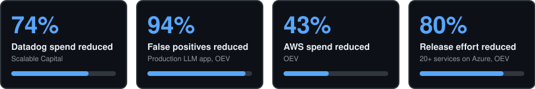

  

  <a href="https://linkedin.com/in/rishi-srinivasan"> LinkedIn</a> ·
  <a href="mailto:rishi.srinivasan95@gmail.com"> Email</a> ·
  <a href="https://rsrinivasan.de"><picture><source media="(prefers-color-scheme: dark)" srcset="assets/icon-portfolio-dark.svg"></picture> Portfolio</a> ·
  <a href="https://medium.com/@rishi.srinivasan95"><picture><source media="(prefers-color-scheme: dark)" srcset="https://cdn.simpleicons.org/medium/ffffff"></picture> Writing</a>

  

## About

- Eight years across machine learning, backend and cloud, in regulated environments: online banking, insurance, healthcare.
- At **Scalable Capital**: own the Datadog platform and the company's LLM gateway.
- Before that at **OEV**: owned a production LLM application for 1000+ users.
- Languages: English (full professional) · German (B1) · French (A2)

## Projects

**[BOTL: Batch on the Label](https://botl.site)** OpenAI DevDay Hackathon, Berlin · 24 Oct 2026 · 3rd place, GTM/Founder category
- Is the product in your hand safe to use? Snap the product and its batch number, and BOTL alerts you the moment the German food authority (BVL) issues an official recall for that batch. Mobile first, for baby products, food, skincare and household items. [Demo video](https://photos.icloud.com/shared/album/0fdb5PcTioO9aIQ27Jz9oxjEA)

How it works

BOTL tells you whether the product in your hand is safe for consumption or not. Take a picture of the product and its batch number; the app, using the ResponseAPI and DecisionAPI, stores it and alerts you when the German food authorities (BVL) publish an official recall for any batch of that product. The mobile-first app covers baby products, food, skincare and other household items. Built for a safe and healthy future.

**[PII gateway](https://github.com/rishi-srinivasan/gtc-berlin-week-hackathon)** GTC Berlin Week hackathon · 19 Oct 2026
- A distilled, self-hosted language model masks PII in German bank and broker support emails, so only masked text reaches a frontier LLM. Leak rate is measured against gold labels.

How it works

Customer support emails and contact forms at regulated enterprises, such as banks and online investment brokers, are full of PII (names, IBANs, tax IDs, depot numbers and more). A small self-hosted language model (SLM), distilled with distil labs from a larger teacher model (gpt-oss-120b), finds the PII in German text. Code then swaps each value for a placeholder such as [IBAN_1], only the masked text reaches the frontier LLM, and the reply is rehydrated with the original values. Leak rate is measured against gold labels, every call is traced in Langfuse, and leak-free teacher traces become new training rows for the next student.

**[llm-eval](https://github.com/rishi-srinivasan/llm-eval)** 17 Sep 2026
- A small, reproducible harness for evaluating coding models as autonomous bug-fixing agents. Each model is driven through the OpenAI Codex CLI inside an isolated Docker container, given a real historical bug from pallets/click, and graded on whether its patch fixes the bug without breaking anything else.

How it works

Choosing a coding model for autonomous bug fixing usually rests on benchmark headlines rather than on how a model behaves on your own codebase, at your own cost and latency. This project is a small, reproducible harness that drives a model through the OpenAI Codex CLI inside an isolated Docker container, hands it a real historical bug from pallets/click, and grades the resulting patch. The six tasks span small to larger fixes. Each one pins Click to the commit before the upstream fix and gives the model only a minimal reproducer. A patch passes only if it keeps the original test suite green and also passes withheld regression tests the model never sees; only the diff under src/ is graded. Every attempt records pass rate, wall-clock time and provider-reported token usage, and time to first token is measured separately. Because the agent loop and sandbox are identical for every model, only the model and provider change. The first run was GLM-5.3 Flash via Ollama Cloud, with 3 repetitions of each task and 16 of 18 attempts passing. Both failures were incomplete fixes that passed the original tests but missed the withheld ones. gpt-5.6-luna is supported for side-by-side comparison, and main is protected so changes land through pull requests.

**[harness-testing](https://github.com/rishi-srinivasan/harness-testing)** 25 Aug 2026

## Experience

 **[Scalable Capital](https://www.scalable.capital)** Cloud Site Reliability Engineer II · Jul 2026 – now · Berlin
- Own the Datadog platform; cut its cost by 74% while keeping observability intact.
- Automated Datadog cost reporting on the Datadog MCP server, replacing about 24 hours a month of manual work; weekly and monthly slides go to the VP Engineering and CTO.
- Operate Bifrost, the LLM gateway: cost, latency and token tracking, MCP connectors, budgets, rate limits and alerts.
- Led a 3-month Dash0 proof of concept as a Datadog replacement: success criteria, 5 core services integrated, governance and permissions, 15+ engineers onboarded in 3 workshops.

 **[OEV](https://www.oev-online.de)** DevOps Engineer, Sparkasse Versicherung Group · Nov 2022 – Jun 2026 · Berlin
- Owned a production LLM application (Python, LangChain, LangGraph) for a healthcare customer, classifying rehabilitation case documents for 1000+ users.
- Built evals with the customer and cut false positives by 94%.
- Designed and ran its cloud infrastructure: containers, CI/CD, guardrails, observability, cost controls.
- Migrated 20+ microservices from on-premises to Azure (AKS, ACI, Terraform) with zero downtime; standardised CI/CD in GitHub Actions and GitLab CI.
- Built a TypeScript document service that pre-fills policy forms from insurance certificates; 200+ multipage documents processed in 3 months.
- Built a market-monitoring pipeline that summarises competitor pricing changes with Slack alerts.
- Started as Associate DevOps Engineer and cut AWS costs by 43%.

 **[Tata Consultancy Services](https://www.tcs.com)** Data Scientist, then Associate Systems Engineer · Sep 2017 – Sep 2021 · Chennai
- Shipped an end-to-end ML pipeline predicting coal properties for JERA, working directly with their engineers.
- Delivered backend and cloud work for Bank of Montreal, Equinor and Transgrid, including a Windows banking monolith moved to cloud-native C# microservices on AWS CDK.

## Writing and teaching

<picture><source media="(prefers-color-scheme: dark)" srcset="https://cdn.simpleicons.org/medium/ffffff"></picture> **[Building Enterprise-Grade Cloud Infrastructure](https://medium.com/@rishi.srinivasan95/building-enterprise-grade-cloud-infrastructure-a-deep-dive-into-oop-and-reusable-components-with-e3441b89168e)** Medium · 29 Nov 2025
- A deep dive into OOP and reusable components with Pulumi.

 **HTW Berlin** Guest lecturer · Summer 2027
- Cloud Computing module of the M.Sc. Professional IT Business and Digitalisation.
- Administrator of the programme's AWS accounts.

## Stack

| | |
|---|---|
| **LLM systems** | LLM gateways, MCP, evals, tool calling, guardrails, RAG, LangChain, LangGraph, Ollama |
| **Observability** | Datadog, Dash0, OpenTelemetry, Prometheus, Grafana, CloudWatch, SLI/SLO design, load testing |
| **Cloud** | AWS (ECS, EKS, Lambda), Azure (AKS, Functions, Entra ID), Kubernetes, Docker |
| **IaC and CI/CD** | Terraform, Pulumi, AWS CDK, GitHub Actions, GitLab CI, Jenkins, AWS CodePipeline |
| **Languages** | Python, TypeScript, C# |
| **Security and FinOps** | Least-privilege IAM, secrets management, cost optimisation, LLM token and rate limiting |

## Education

-  M.Sc. Professional IT Business and Digitalisation, HTW Berlin (GPA 1.58)
- B.Tech Mechanical Engineering, SASTRA University

## Contact

[rishi.srinivasan95@gmail.com](mailto:rishi.srinivasan95@gmail.com) · [LinkedIn](https://linkedin.com/in/rishi-srinivasan) · [rsrinivasan.de](https://rsrinivasan.de)
